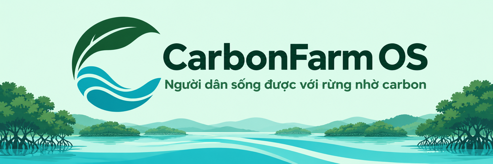

<!-- SPDX-FileCopyrightText: 2026 CarbonFarm OS contributors -->
<!-- SPDX-License-Identifier: GPL-3.0-or-later -->
<p align="center"></p>

# CarbonFarm OS

**Nền tảng nguồn mở tín chỉ carbon cho nông dân nhỏ, hợp tác xã và cộng đồng ven biển** · *An open-source carbon-credit platform for smallholders, cooperatives and coastal communities.*

> "Người dân sống được với rừng nhờ carbon." · *"People can live with the forest thanks to carbon."*

[](LICENSE)

> ⚠️ **Điều kiện dự thi · Eligibility.** Dự án do nhóm DTU3 làm cho OLP PMNM 2026. Trường đã có 2 đội (DTU_DZ_1, DTU_DZ_2) và thể lệ cho phép tối đa 2 đội mỗi trường. DTU3 chỉ dự thi được nếu thay một đội hoặc đăng ký qua trường khác. **Trạng thái: CHỜ XÁC NHẬN.**
> *DTU3 can only enter if it replaces one of the school's two registered teams or enters through another school. Status: pending confirmation.*

## Giới thiệu · Introduction
CarbonFarm OS số hóa **hợp tác xã** như một doanh nghiệp: quản lý xã viên, lô đất, hồ sơ đo lường – báo cáo – xác minh (MRV) và doanh thu từ tín chỉ carbon. Luồng chính:

**đăng ký lô đất → ước lượng carbon từ ảnh Sentinel-2 → duyệt MRV → cấp tín chỉ vào ví → bán cho người mua (mô phỏng) → kiểm chứng trên sổ cái có phiên bản**

*CarbonFarm OS digitises a cooperative: members, land plots, MRV records and credit revenue. Main flow: register a plot → estimate carbon from Sentinel-2 → review MRV → issue credits to a wallet → sell to a (mock) buyer → verify on a versioned ledger.*

Bản MVP: một hệ sinh thái (rừng ngập mặn), một khu vực mẫu, **dữ liệu hợp tác xã là dữ liệu giả**. Registry, người mua, ngân hàng là **connector mô phỏng**; Registry Connector thiết kế theo Thông tư 11/2026/TT-BNNMT. Đề xuất đầy đủ: [`docs/de-xuat.md`](docs/de-xuat.md).

## Kiến trúc · Architecture
- **Tầng 1 – `platform/`:** dịch vụ lõi tổng quát, không chứa nghiệp vụ carbon: SSO (Keycloak), API Gateway (APISIX), bí mật (OpenBao), dữ liệu có cấu trúc + không gian (PostgreSQL + PostGIS, PostGraphile), dữ liệu phi cấu trúc (Versity S3 + danh mục STAC + TiTiler), workflow (Prefect), event bus (Valkey), sổ cái có phiên bản (Dolt).
- **Tầng 2 – `domains/carbon/`:** miền tín chỉ carbon (H-P-D-I, trọng tâm [P] và [D]): hợp tác xã, lô đất, MRV engine, ví tín chỉ, web SvelteKit + MapLibre, dashboard Metabase.
- **`connectors/`:** Registry, Buyer, Bank mô phỏng, mỗi connector có hợp đồng OpenAPI; thay bằng API thật mà không sửa lõi.

Chi tiết và sơ đồ: [`docs/architecture.md`](docs/architecture.md). Các quyết định: [`docs/adr/`](docs/adr/).
*Tier 1 is a generic headless platform; tier 2 holds the carbon domain; connectors are pluggable mocks. See `docs/architecture.md` and the ADRs.*

## Bắt đầu · Getting started
Đang dựng khung (tuần 30/10–08/11/2026). Hiện chạy được Tầng 1 tối thiểu (PostgreSQL + PostGIS, Keycloak, OpenBao chế độ dev, APISIX).
*Work in progress: only a minimal tier 1 runs today.*

```bash
cp .env.example .env      # cấu hình máy dev · dev configuration
task up                   # chạy dịch vụ · start services (go-task)
task smoke                # kiểm thử đầu-cuối bằng Hurl · end-to-end checks
task check                # SPDX + compose, trước mọi PR · before every PR
```
Môi trường dev dùng chung: Dev Container hoặc `pixi install` (xem [`CONTRIBUTING.md`](CONTRIBUTING.md)).

## Đóng góp · Contributing
Trunk-based, Conventional Commits, PR do chủ vùng mã duyệt, phát hành tự động bằng release-please: [`CONTRIBUTING.md`](CONTRIBUTING.md). Quy tắc ứng xử: [`CODE_OF_CONDUCT.md`](CODE_OF_CONDUCT.md). Báo lỗi qua GitHub Issues.

## Giấy phép · License
Mã nguồn: **GPL-3.0-or-later** ([`LICENSE`](LICENSE)). Chọn copyleft để mọi bản sửa đổi của nền tảng MRV công khai cho cộng đồng, giúp con số carbon kiểm chứng được. Thành phần bên thứ ba: [`DEPENDENCIES.md`](DEPENDENCIES.md), [`NOTICE`](NOTICE).
*Source code is GPL-3.0-or-later so that every modified MRV platform stays open and its carbon numbers remain verifiable.*
