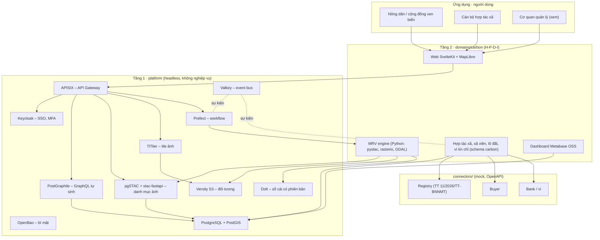

<!-- SPDX-FileCopyrightText: 2026 CarbonFarm OS contributors -->
<!-- SPDX-License-Identifier: GPL-3.0-or-later -->
# Kiến trúc · Architecture

> Bản khung tuần 30/10/2026. Mỗi thay đổi lớn ghi thành ADR trong `docs/adr/`.

## 1. Ba tầng



**Quy tắc ranh giới**
- `platform/` không chứa bảng, vai trò, quy trình hay dữ liệu mẫu của miền carbon (BTC #1396, #1400, #1423). Một miền khác (ví dụ quản lý thủy sản) dùng lại được nguyên Tầng 1.
- Tầng 2 và connector chỉ gọi lõi qua gateway hoặc giao thức chuẩn (S3, STAC, GraphQL).
- Giao diện quản trị của dịch vụ lõi (Keycloak Admin, Prefect UI) chỉ dành cho quản trị viên, đặt sau xác thực (BTC #1393).

**Điểm cắm miền (Tầng 1 không biết tên miền nào)** – Tầng 1 quét `domains/*/` theo quy ước, miền chỉ đặt tệp:

| Tệp trong `domains/<miền>/` | Tầng 1 làm gì |
|---|---|
| `db/migrations/*.sql` | dịch vụ `migrate` áp theo thứ tự tên, mỗi tệp một transaction, ghi `nen_tang.lich_su_migration` (tên + SHA-256); tệp đã áp mà bị sửa → dừng báo lỗi |
| `db/seed/*.sql` | nạp dữ liệu giả khi `NAP_DU_LIEU_MAU=true` (mặc định trong `.env.example`) |
| `bi-mat.txt` | OpenBao sinh thêm các bí mật có tên này vào `/run/bimat/` |
| `gateway/routes.yaml` | ghép vào cấu hình APISIX khi khởi động |
| schema PostgreSQL | lộ qua GraphQL khi thêm vào `GRAPHQL_SCHEMAS` (`.env`) |

**Lỗi nghiệp vụ:** hàm/trigger của miền báo lỗi bằng SQLSTATE bắt đầu bằng `U` (lớp PostgreSQL để dành cho ứng dụng) → PostGraphile trả nguyên thông báo, `extensions.code`, `extensions.hint`; mọi lỗi khác bị che, chỉ trả mã tra log (`platform/postgraphile/graphile.config.mjs`).

Phân quyền dữ liệu miền carbon bằng RLS theo `sub` trong JWT: xã viên thấy lô của mình, cán bộ thấy cả hợp tác xã mình phụ trách, quản trị thấy tất cả (`domains/carbon/db/migrations/001_carbon.sql`, kiểm bằng `tests/e2e/carbon-rls.hurl`).

## 2. Luồng MRV

```mermaid
sequenceDiagram
  autonumber
  actor HTX as Cán bộ HTX
  participant WEB as Web (Tầng 2)
  participant PG as PostgreSQL/PostGIS
  participant PF as Prefect
  participant MRV as MRV engine
  participant CDSE as Copernicus STAC (ngoài)
  participant STAC as pgSTAC + Versity S3
  participant DOLT as Dolt
  participant REG as Registry (mock)
  HTX->>WEB: Đăng ký lô đất (vẽ ranh giới)
  WEB->>PG: Lưu lô; Poka-yoke: không chồng lấn, diện tích khớp hình học
  HTX->>WEB: Yêu cầu đo carbon cho kỳ báo cáo
  WEB->>PF: Chạy flow "uoc-luong-carbon"(lô, kỳ)
  PF->>MRV: Tác vụ
  MRV->>CDSE: Tìm cảnh Sentinel-2 L2A (mây < ngưỡng)
  MRV->>STAC: Lưu cảnh đã cắt (COG) + item STAC
  MRV->>MRV: Chỉ số thực vật × hệ số (methodology/ phiên bản X)
  MRV->>DOLT: Ghi kết quả + phả hệ (mã cảnh, ngày, mây, phiên bản thuật toán, tham số) → commit
  PF-->>HTX: Flow tạm dừng, chờ duyệt
  HTX->>PF: Duyệt / trả lại
  PF->>REG: Đề nghị cấp tín chỉ (mock)
  REG-->>PF: Mã tín chỉ
  PF->>DOLT: Ghi cấp tín chỉ vào ví → commit (mã băm công bố cho người mua)
```

## 3. Sổ cái có phiên bản (Dolt)
- Bảng sổ cái (kết quả MRV, cấp tín chỉ, chuyển nhượng) nằm trong Dolt. Mỗi lần ghi là một commit có mã băm nội dung, giống git.
- Người mua và Registry nhận mã băm commit. Họ kiểm lại bằng `dolt log` / `dolt diff` hoặc qua API đọc công khai.
- Dữ liệu cá nhân không nằm trong sổ cái: chỉ có mã xã viên, mã lô và số liệu.
- Phương án kiểm chứng ngoài (neo mã băm vào nơi công khai) ghi thành ADR khi làm.

## 4. Chạy
- `compose.yaml` ghép `compose/platform.yaml` (Tầng 1).
- `compose/carbon.yaml` và `compose/connectors.yaml` thêm dần.
- Mỗi image ghim phiên bản, giấy phép ở `DEPENDENCIES.md`.
