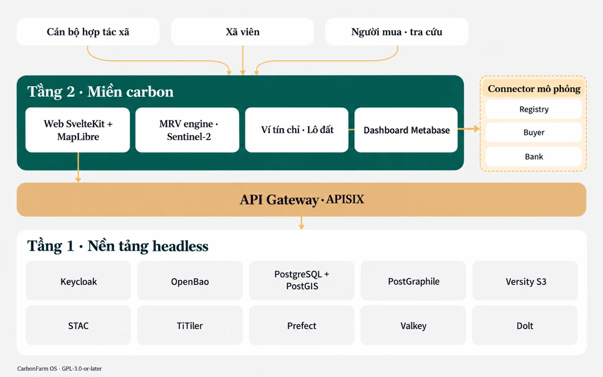
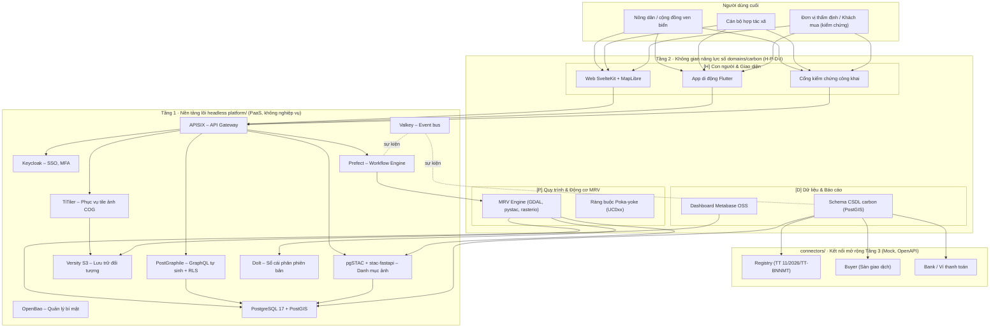

<!-- SPDX-FileCopyrightText: 2026 CarbonFarm OS contributors -->
<!-- SPDX-License-Identifier: GPL-3.0-or-later -->
# Kiến trúc · Architecture

> Bản khung tuần 30/10/2026. Mỗi thay đổi lớn ghi thành ADR trong `docs/adr/`.

## 1. Mô hình kiến trúc hai tầng (DX-OS Open-Core)

Hệ thống tuân thủ chặt chẽ đề bài OLP PMNM 2026 về kiến trúc DX-OS Open-Core:
- **Tầng 1 – Nền tảng Dịch vụ Lõi số (`platform/`):** Chạy ở chế độ Headless (không có giao diện người dùng cuối, chỉ có API và UI quản trị kỹ thuật), độc lập hoàn toàn với nghiệp vụ carbon. Cung cấp đầy đủ 4 năng lực cốt lõi bắt buộc: Định danh SSO/MFA, API Gateway, Dữ liệu cấu trúc/phi cấu trúc, và Workflow Engine; kết hợp Quản lý bí mật, Event bus và Sổ cái phiên bản.
- **Tầng 2 – Không gian Năng lực số (`domains/carbon/`):** Ứng dụng minh họa hoàn chỉnh theo chuẩn **H-P-D-I**:
  - **[H] Con người:** Web SvelteKit, App di động Flutter, Cổng kiểm chứng độc lập `/kiem-chung`.
  - **[P] Quy trình:** Tự động hóa đo lường MRV qua Prefect, luân chuyển phê duyệt hai cấp theo Thông tư 11/2026/TT-BNNMT, rào chắn Poka-yoke chặn sai từ CSDL.
  - **[D] Dữ liệu:** Bản đồ WebGIS MapLibre, phả hệ viễn thám, Sổ cái Dolt bất biến, Dashboard Metabase OSS.
  - **[I] Trí tuệ số:** Ước lượng sinh khối carbon và tán rừng từ dữ liệu vệ tinh Sentinel-2 theo phương pháp luận IPCC Tier 1.
- **Kết nối mở rộng Tầng 3 (Hệ sinh thái cắm–rút):** Thư mục `connectors/` (mô phỏng Registry quốc gia, Sàn giao dịch Buyer, Ngân hàng thanh toán qua hợp đồng OpenAPI) và quy chế cắm–rút miền nghiệp vụ (`domains/`) sẵn sàng kết nối sang Tầng 3 (Kinh doanh số ngành dọc) mà không sửa đổi Tầng 1.



Sơ đồ chi tiết các thành phần dịch vụ và luồng phụ thuộc:



**Quy tắc ranh giới**
- `platform/` không chứa bảng, vai trò, quy trình hay dữ liệu mẫu của miền carbon (BTC #1396, #1400, #1423). Một miền khác (ví dụ quản lý thủy sản) dùng lại được nguyên Tầng 1.
- Tầng 2 và connector chỉ gọi lõi qua gateway hoặc giao thức chuẩn (S3, STAC, GraphQL).
- Giao diện quản trị của dịch vụ lõi (Keycloak Admin, Prefect UI) chỉ dành cho quản trị viên, đặt sau xác thực (BTC #1393).

**Điểm cắm miền (Tầng 1 không biết tên miền nào)** – Tầng 1 quét `domains/*/` theo quy ước, miền chỉ đặt tệp:

| Tệp trong `domains/<miền>/` | Tầng 1 làm gì |
|---|---|
| `db/migrations/*.sql` | dịch vụ `migrate` áp theo thứ tự tên, mỗi tệp một transaction, ghi `nen_tang.lich_su_migration` (tên + SHA-256); tệp đã áp mà bị sửa → dừng báo lỗi |
| `db/seed/*.sql` | nạp dữ liệu giả khi `NAP_DU_LIEU_MAU=true` (mặc định trong `.env.example`) |
| `bi-mat.txt` | OpenBao sinh thêm các bí mật có tên này vào `/run/bimat/` |
| `gateway/routes.yaml` | ghép vào cấu hình APISIX khi khởi động |
| schema PostgreSQL | lộ qua GraphQL khi thêm vào `GRAPHQL_SCHEMAS` (`.env`) |

Hướng dẫn viết miền mới, kèm miền mẫu cắm–rút: [`docs/viet-mien.md`](viet-mien.md).

**Lỗi nghiệp vụ:** hàm/trigger của miền báo lỗi bằng SQLSTATE bắt đầu bằng `U` (lớp PostgreSQL để dành cho ứng dụng) → PostGraphile trả nguyên thông báo, `extensions.code`, `extensions.hint`; mọi lỗi khác bị che, chỉ trả mã tra log (`platform/postgraphile/graphile.config.mjs`).

**MRV (ADR 0005):** người dùng chỉ đi qua GraphQL (`carbonYeuCauMrv`, `carbonDuyetKetQuaMrv`, quyền và luật trong CSDL). Tiến trình `carbon-mrv` thăm dò `carbon.ket_qua_mrv`: dòng mới → tạo lượt chạy Prefect `mrv-lo-dat/carbon`; có quyết định → resume lượt chạy đang PAUSED; được duyệt → flow ghi Dolt. Vai đăng nhập của miền khai ở `domains/<miền>/db/vai-dang-nhap.txt`, Tầng 1 đặt mật khẩu từ OpenBao.

Phân quyền dữ liệu miền carbon bằng RLS theo `sub` trong JWT: xã viên thấy lô của mình, cán bộ thấy cả hợp tác xã mình phụ trách, quản trị thấy tất cả (`domains/carbon/db/migrations/001_carbon.sql`, kiểm bằng `tests/e2e/carbon-rls.hurl`).

## 2. Luồng MRV

```mermaid
sequenceDiagram
  autonumber
  actor HTX as Cán bộ HTX
  participant WEB as Web (Tầng 2)
  participant PG as PostgreSQL/PostGIS (GraphQL, RLS)
  participant CN as carbon-mrv (cầu nối + flow)
  participant PF as Prefect
  participant ES as Earth Search STAC (ngoài)
  participant STAC as pgSTAC + Versity S3
  participant DOLT as Dolt
  participant REG as Registry (mock)
  HTX->>WEB: Đăng ký lô đất (vẽ ranh giới)
  WEB->>PG: carbonDangKyLoDat – Poka-yoke: hình hợp lệ, 0,05–500 ha, lệch ≤ 10 %, không chồng lấn
  HTX->>WEB: Yêu cầu đo cho kỳ
  WEB->>PG: carbonYeuCauMrv – không đo chồng kỳ → dòng "cho_chay"
  CN->>PG: thăm dò, thấy yêu cầu mới
  CN->>PF: tạo lượt chạy mrv-lo-dat/carbon
  PF->>CN: chạy flow
  CN->>ES: tìm cảnh Sentinel-2 L2A C1 ít mây, đọc cửa sổ đỏ/NIR/SCL
  CN->>CN: NDVI + SCL → diện tích tán × hệ số IPCC (methodology v0.1)
  CN->>STAC: COG NDVI + item STAC (derived_from → cảnh nguồn)
  CN->>PG: kết quả + phả hệ → "cho_duyet"; flow PAUSED
  HTX->>WEB: Xem bản đồ + số liệu, duyệt / từ chối (kèm lý do)
  WEB->>PG: carbonDuyetKetQuaMrv
  CN->>PF: resume lượt chạy
  CN->>DOLT: được duyệt → ghi bản ghi + DOLT_COMMIT
  CN->>PG: mã băm commit, SHA-256 → "da_ghi_so"
  HTX->>WEB: Đề nghị cấp tín chỉ (1 tín chỉ = 1 t CO₂e, làm tròn xuống)
  WEB->>PG: carbonDeNghiCapTinChi – chỉ kết quả đã ghi sổ, mỗi kết quả một lần
  CN->>REG: tài khoản gắn mã số thuế + đăng ký tín chỉ → mã trong nước, dải sê-ri (TT 11/2026)
  CN->>DOLT: bản ghi cấp (trỏ về commit MRV gốc) → commit
  CN->>PG: khối sê-ri vào ví hợp tác xã → "da_cap"
  HTX->>WEB: Cán bộ A tạo lệnh bán (người mua, số lượng, đơn giá)
  WEB->>PG: carbonTaoLenhBan – không vượt số dư khả dụng
  HTX->>WEB: Cán bộ B duyệt (TT 11/2026 Điều 6 khoản 3: người tạo không tự duyệt)
  CN->>REG: Buyer mock chấp nhận → Registry chuyển quyền sở hữu sê-ri → Bank mock ghi có
  CN->>DOLT: bản ghi bán (người tạo, người duyệt, dải sê-ri) → commit
  CN->>PG: trừ dải sê-ri khỏi ví → "hoan_tat"
```

**Kiểm chứng công khai (#38):** `/kiem-chung` (web) và `/kiem-chung/api/*` (không JWT, chỉ GET, 60 yêu cầu/phút mỗi IP). Dịch vụ `carbon-kiem-chung` đọc Dolt bằng tài khoản **chỉ đọc** `so_cai_doc` (Tầng 1, `platform/dolt/tai-khoan-chi-doc.sh`):
- tính lại SHA-256 từng bản ghi bằng cùng dạng JSON chuẩn lúc ghi (`mrv/json_chuan.py`);
- báo bản ghi còn nguyên vẹn ở HEAD hay đã bị sửa sau;
- tra theo sê-ri ra chuỗi MRV → cấp → bán;
- ẩn trường `*_sub`.

**Dashboard (#39, ADR 0007):** Metabase OSS đọc schema `carbon_bao_cao` gồm các view tổng hợp, không dữ liệu cá nhân. Vai `carbon_bao_cao` chỉ có quyền SELECT trên các view này, giao dịch mặc định chỉ đọc. Container `metabase-dung-dashboard` dựng dashboard qua API lúc khởi động. UI ở `http://127.0.0.1:3001`, tài khoản `quan-tri@carbonfarm.invalid`, mật khẩu trong OpenBao (`metabase-admin`).

## 3. Sổ cái có phiên bản (Dolt)
- Bảng sổ cái (kết quả MRV, cấp tín chỉ, chuyển nhượng) nằm trong Dolt. Mỗi lần ghi là một commit có mã băm nội dung, giống git.
- Người mua và Registry nhận mã băm commit. Họ kiểm lại bằng `dolt log` / `dolt diff` hoặc qua API đọc công khai.
- Dữ liệu cá nhân không nằm trong sổ cái: chỉ có mã xã viên, mã lô và số liệu.
- Phương án kiểm chứng ngoài (neo mã băm vào nơi công khai) ghi thành ADR khi làm.

## 4. Chạy
- `compose.yaml` ghép `compose/platform.yaml` (Tầng 1).
- `compose/carbon.yaml` và `compose/connectors.yaml` thêm dần.
- Mỗi image ghim phiên bản, giấy phép ở `DEPENDENCIES.md`.
