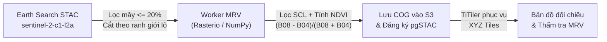
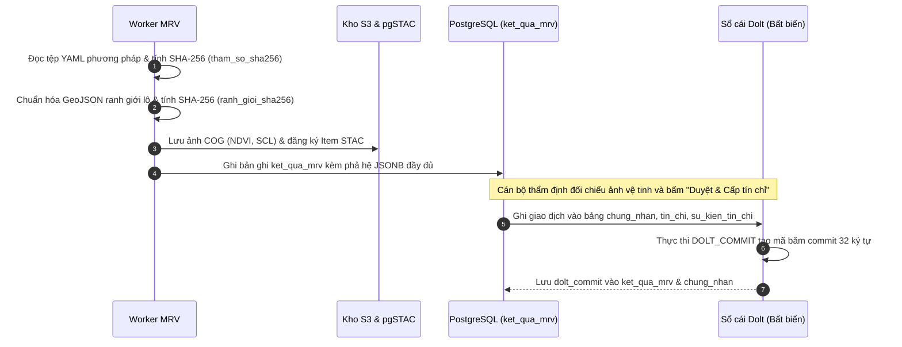

<!-- SPDX-FileCopyrightText: 2026 CarbonFarm OS contributors -->
<!-- SPDX-License-Identifier: GPL-3.0-or-later -->
# Báo cáo giải trình phương pháp luận IPCC Tier 1 và viễn thám Sentinel-2

Tài liệu này giải trình toàn diện quy trình **Đo đạc – Báo cáo – Thẩm tra (MRV)** trên nền tảng **CarbonFarm OS**, phục vụ các đơn vị thẩm định độc lập (VVBs), cơ quan quản lý và hợp tác xã kiểm chứng tính minh bạch từ ảnh vệ tinh gốc tới từng tín chỉ carbon được cấp trên sổ cái Dolt.

---

## 1. Cơ sở phương pháp luận IPCC và hệ số tính toán

Hệ thống tách biệt hoàn toàn **mã nguồn thực thi MRV** (`domains/carbon/mrv/`) và **bộ tham số khoa học** (`methodology/*.yaml`), cho phép nâng cấp hoặc bổ sung phương pháp cho các hệ sinh thái mới mà không thay đổi kiến trúc lõi.

### 1.1. Rừng ngập mặn – IPCC Tier 1 Gain-Loss (`v0.1-rung-ngap-man-ipcc-tier1`)

Áp dụng *2006 IPCC Guidelines for National Greenhouse Gas Inventories* (Tập 4 – AFOLU, Chương 2, Phương trình 2.9 & 2.10) kết hợp *2013 Supplement to the 2006 IPCC Guidelines: Wetlands* (Chương 4 – Coastal Wetlands, vùng khí hậu *Tropical Wet*):

$$\Delta C_G = A \times G_W \times (1 + R) \times CF \times \frac{t}{365} \quad [\text{t C}]$$

$$\Delta \text{CO}_2\text{e} = \Delta C_G \times \frac{44}{12} \quad [\text{t CO}_2\text{e}]$$

Để tuân thủ **nguyên tắc thận trọng (Conservativeness)** trong kiểm kê tín chỉ carbon, CarbonFarm OS sử dụng **cận dưới của khoảng tin cậy 95% (95% CI)** thay vì giá trị trung bình cho toàn bộ các hệ số sinh khối:

| Tham số | Ý nghĩa khoa học | Trung bình IPCC | KTC 95% | Giá trị áp dụng (`v0.1`) | Tham chiếu tài liệu IPCC Wetlands 2013 |
|---|---|---|---|---|---|
| $G_W$ | Tăng trưởng sinh khối khô trên mặt đất (t d.m./ha/năm) | 9,9 | 9,4 – 10,4 | **9,4** | Bảng 4.4, trang 4.14 |
| $R$ | Tỷ lệ sinh khối dưới mặt đất so với trên mặt đất | 0,49 | 0,47 – 0,51 | **0,47** | Bảng 4.5, trang 4.14 |
| $CF$ | Tỷ lệ hàm lượng carbon trong sinh khối khô (t C / t d.m.) | 0,451 | 0,429 – 0,471 | **0,429** | Bảng 4.2, trang 4.13 |
| $B_{\max}$ | Trần sinh khối trên mặt đất khi rừng đạt trạng thái ổn định (t d.m./ha) | 192 | 187 – 204 | **187** | Bảng 4.3, trang 4.14 |
| $44/12$ | Hệ số quy đổi khối lượng phân tử $\text{CO}_2 / \text{C}$ | 3,6667 | – | **3,6667** | Hằng số hóa học |

- **Hệ số hấp thụ tổng hợp thận trọng:** $9,4 \times (1 + 0,47) \times 0,429 \times \frac{44}{12} \approx \mathbf{21,74\text{ t CO}_2\text{e/ha/năm}}$ (thấp hơn $\sim 10,9\%$ so với mức trung bình $24,39\text{ t CO}_2\text{e/ha/năm}$ nhằm triệt tiêu nguy cơ cấp khống tín chỉ).
- **Quy tắc trần sinh khối ($B_{\max}$):** Khi tuổi rừng tích lũy chạm ngưỡng $B_{\max} / G_W = 187 / 9,4 \approx 19,89\text{ năm}$, hệ thống tự động dừng ghi nhận tăng trưởng sinh khối mới và gắn cờ `cham_tran_sinh_khoi`.
- **Quy tắc chống suy thoái tán (`mat_tan`):** Diện tích tính toán luôn lấy $A = \min(A_{\text{đo}}, A_{\text{lô}}, A_{\text{kỳ trước}})$. Nếu diện tích tán giảm vượt ngưỡng $10\%$ so với kỳ liền trước, hệ thống tự động gắn cờ `mat_tan` và chuyển sang quy trình thẩm tra thủ công.

### 1.2. Khả năng mở rộng cho canh tác lúa nước giảm phát thải (AWD – IPCC 2006/2019)

Kiến trúc tệp tham số `methodology/` hỗ trợ mở rộng sang phương pháp giảm phát thải khí mê-tan ($\text{CH}_4$) trong canh tác lúa nước tưới **Ngập – Khô xen kẽ (Alternate Wetting and Drying – AWD)** theo *2019 Refinement to the 2006 IPCC Guidelines* (Tập 4, Chương 5, Mục 5.5):

- **Phát thải cơ sở (Baseline – ngập liên tục):** $EF_c = 1,22\text{ kg CH}_4\text{/ha/ngày}$ (vùng Đông Nam Á, hệ số hiệu chỉnh chế độ nước $SF_w = 1,0$).
- **Kịch bản dự án (Áp dụng AWD nhiều đợt rút nước):** Hệ số hiệu chỉnh chế độ nước trong vụ $SF_w = 0,55$ (giảm $\sim 45\%$ lượng phát thải $\text{CH}_4$ so với ngập nước liên tục).
- **Quy đổi $\text{CO}_2\text{e}$:** Nhân với tiềm năng nóng lên toàn cầu $GWP_{100}(\text{CH}_4) = 27,9$ (IPCC AR6).

---

## 2. Quy trình thu thập ảnh vệ tinh Sentinel-2 qua pgSTAC và tính toán NDVI

Luồng xử lý viễn thám tự động hóa hoàn toàn từ danh mục STAC mở đến lưu trữ Cloud-Optimized GeoTIFF (COG) nội bộ qua điều phối của **Prefect** (`domains/carbon/mrv/mrv/luong.py`).

### 2.1. Tuyển chọn cảnh ảnh và chuẩn hóa bức xạ

1. **Nguồn dữ liệu:** Truy vấn danh mục STAC công khai `sentinel-2-c1-l2a` (Sentinel-2 Collection 1 Level-2A phản xạ bề mặt BOA) theo khung bao (bounding box) của lô đất và khoảng thời gian kỳ giám sát.
2. **Băng phổ sử dụng:**
   - Băng đỏ `red` (**B04**, bước sóng trung tâm $665\text{ nm}$, độ phân giải không gian $10\text{ m}$).
   - Băng cận hồng ngoại `nir` (**B08**, bước sóng trung tâm $842\text{ nm}$, độ phân giải không gian $10\text{ m}$).
   - Băng phân loại cảnh `scl` (**Scene Classification Layer**, độ phân giải $20\text{ m}$, lấy mẫu lại về lưới $10\text{ m}$ theo phương pháp láng giềng gần nhất – *nearest neighbor*).
3. **Hiệu chỉnh giá trị phản xạ thực:** Đọc siêu dữ liệu `raster:bands` (`scale` và `offset`) của từng asset COG để quy đổi giá trị số (DN) về phản xạ bề mặt chuẩn, khắc phục triệt để sai lệch baseline `04.00` của ESA (chi tiết tại [ADR 0005](adr/0005-mrv-engine-va-cau-noi-prefect.md)).

### 2.2. Mặt nạ lọc mây SCL và ngưỡng hợp lệ 80%

Trong chu kỳ thu nhận ảnh vệ tinh Sentinel-2 (tần suất bay lặp lại mỗi 5 ngày, tổng hợp theo chu kỳ giám sát 16–30 ngày), mỗi điểm ảnh nằm trong ranh giới hình học của lô đất (`carbon.lo_dat.hinh`) được kiểm tra qua mặt nạ chất lượng **Sen2Cor SCL**:

- **Điểm ảnh bị loại bỏ (không hợp lệ):** Lớp `0` (Không dữ liệu), `1` (Bão hòa/lỗi cảm biến), `3` (Bóng mây), `8` (Mây xác suất trung bình), `9` (Mây xác suất cao), `10` (Mây ti mỏng – Cirrus).
- **Quy tắc tuyển chọn cảnh tốt nhất trong kỳ:**
  - Chỉ xét các cảnh có độ che phủ mây toàn cảnh `eo:cloud_cover <= 20%`.
  - Trong số các cảnh tìm được, hệ thống chọn cảnh có **tỷ lệ điểm ảnh hợp lệ trong lô cao nhất**.
  - Nếu cảnh tốt nhất vẫn có tỷ lệ điểm ảnh hợp lệ **dưới 80%** (`ti_le_hop_le_toi_thieu: 0.80`), hệ thống **từ chối ước lượng** (không nội suy dữ liệu giả) và trả về thông báo hướng dẫn người dùng chọn kỳ mùa khô ít mây.

### 2.3. Công thức chỉ số thực vật NDVI và diện tích tán rừng

Với các điểm ảnh hợp lệ trong lô, chỉ số thực vật khác biệt chuẩn hóa (**NDVI**) được tính theo công thức Rouse và cộng sự (1974):

$$\text{NDVI} = \frac{\rho_{\text{NIR}} - \rho_{\text{Red}}}{\rho_{\text{NIR}} + \rho_{\text{Red}}} = \frac{\text{B08} - \text{B04}}{\text{B08} + \text{B04}}$$

- **Điều kiện điểm ảnh thuộc tán rừng ngập mặn:** Điểm ảnh đạt đồng thời `SCL == 4` (Thực vật) **và** $\text{NDVI} \ge 0,40$.
- **Quy đổi diện tích tán ($A$):** Mỗi điểm ảnh lưới $10\text{ m} \times 10\text{ m}$ tương ứng $100\text{ m}^2 = 0,01\text{ ha}$:
  $$A = \min\left(N_{\text{tán}} \times 0,01,\; A_{\text{ranh giới lô}}\right) \quad [\text{ha}]$$

---

## 3. Cơ chế ghi nhận phả hệ và niêm phong bằng chứng SHA-256 trên sổ cái Dolt

Để chống gian lận số liệu (*Greenwashing*) và đảm bảo khả năng tái lập 100% khi kiểm toán độc lập, mọi bước từ lúc đo đạc tới khi phát hành tín chỉ đều được khóa bằng hàm băm mật mã **SHA-256** và lưu vết bất biến trên cơ sở dữ liệu phân nhánh **Dolt** ([ADR 0003](adr/0003-so-cai-co-phien-ban-bang-dolt.md)).

### 3.1. Các thành phần được niêm phong trong Phả hệ (`pha_he`)

Mỗi bản ghi `carbon.ket_qua_mrv` lưu trữ trường JSONB `pha_he` chứa đầy đủ dấu vân tay số của toàn bộ chuỗi xử lý:

1. **Dấu vân tay phương pháp (`tham_so_sha256`):** Mã băm SHA-256 của tệp `methodology/v0.1-rung-ngap-man-ipcc-tier1.yaml` tại thời điểm chạy. Nếu tệp tham số bị sửa dù chỉ 1 ký tự, mã băm sẽ thay đổi hoàn toàn.
2. **Dấu vân tay không gian (`ranh_gioi_sha256`):** Mã băm SHA-256 của chuỗi GeoJSON ranh giới lô đất đã chuẩn hóa tọa độ, ngăn chặn việc thay đổi diện tích lô sau khi đã đo.
3. **Định danh ảnh gốc và sản phẩm (`canh_nguon_id`, `stac_item_id`):** Mã định danh cảnh Sentinel-2 gốc từ Earth Search STAC và đường dẫn tệp ảnh COG đã cắt lưu trong kho S3 nội bộ.
4. **Thống kê điểm ảnh chi tiết:** Tổng số điểm ảnh trong lô (`diem_anh_trong_lo`), số điểm ảnh sạch không mây (`diem_anh_hop_le`), số điểm ảnh đạt ngưỡng tán rừng (`diem_anh_tan`) và chỉ số NDVI trung bình trên tán (`ndvi_trung_binh_tan`).

### 3.2. Cam kết bất biến trên sổ cái Dolt (`dolt_commit`)

Khi cán bộ thẩm định phê duyệt kết quả MRV:

- Hệ thống ghi nhận chứng nhận carbon (`chung_nhan`), từng tín chỉ có số sê-ri duy nhất (`tin_chi`) và sự kiện phát hành (`su_kien_tin_chi`) vào sổ cái **Dolt**, sau đó thực thi `CALL DOLT_COMMIT(...)`.
- Mã commit của Dolt (chuỗi băm dạng Git như `t28k82q8u57bpnv76q91l3b723m7ck9p`) được trả về và gắn cố định vào chứng nhận cũng như trang tra cứu công khai `/kiem-chung/<ma_chung_nhan>`.
- Bất kỳ bên thứ ba nào cũng có thể đối chiếu lịch sử thay đổi qua bảng hệ thống `dolt_log` và `dolt_diff_tin_chi` để xác thực không có tín chỉ nào bị sửa đổi hay bán trùng lặp.
